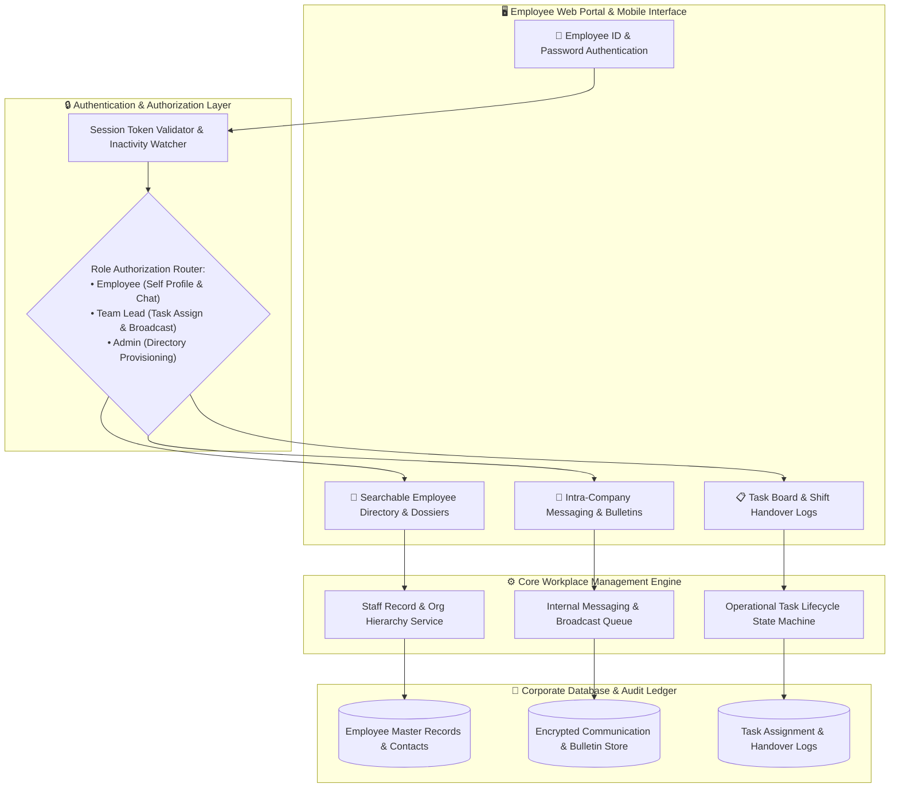

# 👥 SprakDigiTask — Internal Employee Portal & Workforce Communication Platform

<div align="center">

### **Centralized Staff Directory, Employee Authentication, Intra-Company Messaging & Workplace Task Telemetry**

[](https://www.sprakdigitask.liveblog365.com/index.php?i=1)
[](https://www.sprakdigitask.liveblog365.com/index.php?i=1)
[](https://rahaman1721.framer.website)
[]()

<br/>

Designed & Developed by **[Obaidhur Rahaman](https://rahaman1721.framer.website)** · Full Stack Developer & UI/UX Designer  
*Connecting distributed team members through unified staff profiles, secure role logins, and real-time internal communication channels.*

</div>

---

## 🌐 Live Production Access

Explore the live enterprise employee portal: **[https://www.sprakdigitask.liveblog365.com/index.php?i=1](https://www.sprakdigitask.liveblog365.com/index.php?i=1)**

---

## 1. Project Title, Badges & Vision

### 🏢 The Vision: Streamlined Workplace Collaboration & Employee Visibility
In fast-moving organizations, internal operations frequently break down when employee contact details, team assignments, and operational updates are fragmented across disorganized spreadsheets and consumer chat apps.

**SprakDigiTask** is an internal corporate workforce hub engineered to solve operational friction:
1. **Unified Staff Directory:** Fast lookup of team members, roles, reporting managers, and direct internal communication coordinates.
2. **Secure Role-Based Employee Login:** Gated authentication separating standard employees, departmental leads, and administrative human resource managers.
3. **Internal Team Communication Channels:** Frictionless intra-office messaging, team bulletin boards, and urgent operational announcements without reliance on personal chat apps.
4. **Daily Task Accountability:** Integrated task assignment and operational status tracking ensuring alignment across ongoing business workflows.

---

## 2. Exhaustive Module & Feature Breakdown

### 🔐 Module A: Employee Authentication & Role-Based Access Control (RBAC)
- **Employee ID & Credential Login**: Multi-tenant sign-in gateway with secure credential hashing and session management.
- **Hierarchical Access Levels**:
  - **Employee Tier**: Personal profile management, internal staff directory browsing, direct messaging, and assigned task logging.
  - **Team Lead Tier**: Departmental task assignments, announcement broadcasting, and team attendance oversight.
  - **Administrator Tier**: Employee onboarding, credential provisioning, department configuration, and audit logs.
- **Session Protection**: Automatic timeout on inactive terminals to safeguard internal company data.

### 👤 Module B: Employee Directory & Comprehensive Profile Management
- **Searchable Staff Directory**: Instant auto-complete search filtering employees by name, department, designation, or extension code.
- **Granular Employee Dossiers**:
  - Work Details: Official designation, department, reporting manager, date of joining, operational shift.
  - Contact Details: Internal phone extension, company email, desk location.
  - Emergency & Next-of-Kin Contacts: Securely stored and accessible by HR during medical emergencies.
- **Self-Service Profile Updates**: Employees can update bio information, skills, and emergency contact details with change-audit logging.

### 💬 Module C: Internal Communication & Team Announcements
- **Intra-Office Direct Messaging**: Real-time communication channel enabling staff to collaborate across departments without external tooling.
- **Departmental Bulletin Boards**: Dedicated broadcast spaces for management updates, policy announcements, holiday schedules, and team achievements.
- **Urgent Notification Pushes**: Visual alert banners for time-sensitive operational alerts and system maintenance windows.

### 📋 Module D: Daily Task Allocation & Operational Tracking
- **Task Assignment Engine**: Managers assign actionable operational tasks with due dates, priority tags (Urgent, Normal, Low), and file references.
- **Employee Work Status Updates**: Staff toggle task states (`Pending` $\rightarrow$ `In Progress` $\rightarrow$ `Under Review` $\rightarrow$ `Completed`) with completion timestamps.
- **Daily Handover Notes**: Enables smooth shift transitions by logging daily operational summaries between outgoing and incoming personnel.

### 📱 Module E: Responsive Workplace Experience & Accessibility
- **Cross-Device Usability**: Fluid responsive layout engineered for desktop office workstations, warehouse tablets, and field smartphones.
- **High-Contrast Readability**: Scannable typography and high-contrast tables designed for rapid data retrieval in busy office environments.

---

## 3. System Architecture & Tech Stack



| Layer | Technologies | Architectural Function |
|:---|:---|:---|
| **Frontend Interface** | HTML5, CSS3, JavaScript, Responsive Grid | Cross-browser compatible corporate web application. |
| **Backend & Routing** | PHP / Server-Side Architecture | Secure session management, REST APIs, and database orchestration. |
| **Database Layer** | Relational Database (MySQL) | Structured storage for employee rosters, department hierarchies, and task ledgers. |
| **Security & Auth** | Role-Based Access Control (RBAC), Session Tokens | Gated access protecting private employee personal details and company communications. |

---

## 4. Complete Folder Structure

```
sprakdigitask-crm/
├── documentation/                        # Comprehensive Architectural Case Study & Guides
│   ├── ARCHITECTURE.md                   # System design, data models, and RBAC matrix
│   └── USER_WORKFLOWS.md                 # Staff directory and internal messaging flows
├── public/                               # Static assets, branding logos, and CSS stylesheets
├── src/                                  # Core Application Codebase
│   ├── auth/                             # Login controllers, session validators, and password recovery
│   ├── directory/                        # Employee directory search, profile cards, and department trees
│   ├── communication/                    # Internal messaging panels, bulletin broadcasts, and alert tickers
│   ├── tasks/                            # Task board, assignment modals, and status toggle handlers
│   └── config/                           # Database connection settings and access rules
├── index.php                             # Main application gateway and router
├── README.md                             # Production repository documentation
└── package.json                          # Asset pipeline and development tooling scripts
```

---

## 5. Screen / Route Inventory

| Screen View | Primary User Role | Operational Purpose |
|:---|:---|:---|
| `Login / Index` | Public / Employee | Secure Employee ID authentication gateway with session check. |
| `Staff Directory` | All Authenticated | Searchable employee roster with department filters and quick contact links. |
| `Employee Profile` | Employee / Admin | Comprehensive personal and work dossier, skills, and emergency contact details. |
| `Team Chat & Bulletins` | All Authenticated | Intra-office communication channels and management announcement boards. |
| `Task Board` | Employee / Lead | Daily operational task assignments, status tracking, and shift handover notes. |
| `Admin Portal` | HR / Admin Only | Employee onboarding, role provisioning, and departmental restructuring. |

---

## 6. Getting Started (Local Setup & Installation)

### Prerequisites
- **Web Server**: Apache / Nginx or PHP Local Server (`PHP 8.0+`).
- **Database**: MySQL 5.7+ or MariaDB.
- **Browser**: Any modern web browser (Chrome, Edge, Firefox, Safari).

### 1. Clone Repository
```bash
git clone https://github.com/rahaman1721/sprakdigitask-crm.git
cd sprakdigitask-crm
```

### 2. Configure Database Connection
Set up your local database credentials in `config/db.php`:
```php
<?php
define('DB_HOST', 'localhost');
define('DB_USER', 'root');
define('DB_PASS', '');
define('DB_NAME', 'sprakdigitask_db');
?>
```

### 3. Launch Local Server
```bash
php -S localhost:8000
```
Open **[http://localhost:8000](http://localhost:8000)** in your browser!

---

## 👨‍💻 Author

**Obaidhur Rahaman**  
Full Stack Developer & Lead UI/UX Designer  

- 🌐 **Portfolio**: [https://rahaman1721.framer.website](https://rahaman1721.framer.website)  
- 🐙 **GitHub**: [@rahaman1721](https://github.com/rahaman1721)  
- 💼 **LinkedIn**: [linkedin.com/in/obaidhur-rahaman-1721z](https://www.linkedin.com/in/obaidhur-rahaman-1721z)  
- 📧 **Email**: [rahaman171920@gmail.com](mailto:rahaman171920@gmail.com)  

<div align="center">
  <sub>Designed & Developed with precision by Obaidhur Rahaman © 2026</sub>
</div>
